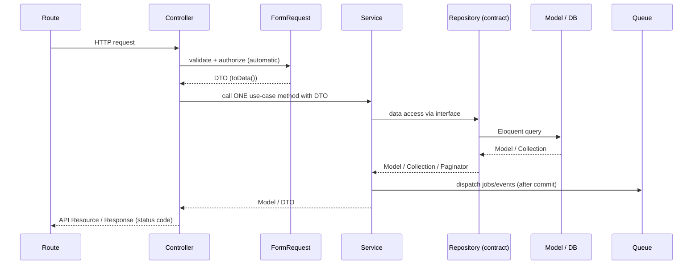

---
paths:
  - "app/**"
  - "routes/**"
  - "bootstrap/app.php"
  - "bootstrap/providers.php"
---

# Architecture standard — Controller → Service → Repository

> **Version:** 1.0 · **Owner:** `architect` agent + tech lead · **Applies to:** Laravel 11+ (for 10.x use the `Kernel`/`Handler` equivalents).
> **How it changes:** the architect proposes changes in the "Proposed changes to the standard" section of its reports; the team approves; then this file is edited, the version bumped and the changelog updated. Agents never edit this file on their own.

## 1. Goals

1. **Predictability** — any developer can guess where a piece of logic lives.
2. **Separation of concerns** — HTTP, business rules and data access change for different reasons, so they live in different classes.
3. **Replaceable data access** — services depend on repository *contracts*, not on Eloquent.
4. **Responsive requests** — anything the user doesn't need to wait for runs on a queue.
5. **Readable code** — clean-code rules (§8) over cleverness.

## 2. Request lifecycle



## 3. Directory layout

Layer-first, grouped by domain inside each layer (`Billing`, `Catalog`, `Identity`, …).

```text
app/
├── Http/
│   ├── Controllers/{Api,Web}/<Domain>/   # thin; resource or single-action (__invoke)
│   ├── Requests/<Domain>/                # validation + authorize() + toData()
│   ├── Resources/<Domain>/               # output shaping
│   └── Middleware/
├── DTOs/<Domain>/                        # final readonly data carriers
├── Services/<Domain>/                    # business rules, orchestration, transactions
├── Repositories/
│   ├── Contracts/<Domain>/               # <Name>RepositoryInterface
│   └── Eloquent/<Domain>/                # Eloquent<Name>Repository
├── Models/                               # Eloquent models (flat, Laravel default)
├── Enums/<Domain>/                       # backed enums (statuses, types)
├── Jobs/<Domain>/                        # queued work (thin → calls a service)
├── Events/<Domain>/  Listeners/<Domain>/
├── Policies/                             # authorization per model
├── Exceptions/<Domain>/                  # domain exceptions
├── Integrations/<Vendor>/                # adapters for third-party APIs (interface + client)
└── Providers/RepositoryServiceProvider.php
```

## 4. Layer contracts

### 4.1 Routes
- **MUST:** be named (`invoices.store`), use kebab-case plural nouns, group by middleware (`auth:sanctum`, `throttle:*`), use scoped route-model binding for nested resources (`->scopeBindings()`).
- **MUST NOT:** contain closures with logic (closures also break `route:cache`).

### 4.2 Controllers — HTTP adapter only
- **Responsibility:** receive the request, hand a DTO to **one** service method, return a Resource/Response with the correct status code.
- **MUST:** inject services through the constructor; type-hint FormRequests; return `JsonResource`/`Response`; use single-action controllers (`__invoke`) for non-CRUD actions; stay under ~10 lines per action.
- **MUST NOT:** query Eloquent (`Model::query()`, `->where()`), contain business rules, open transactions, dispatch jobs, call repositories, use `try/catch` for flow control, call `$request->all()`.
- **Allowed exception:** route-model binding (`Invoice $invoice`) to load the subject for authorization; then pass it to the service.

```php
final class InvoiceController extends Controller
{
    public function __construct(private readonly InvoiceService $invoices) {}

    public function store(StoreInvoiceRequest $request): JsonResponse
    {
        $invoice = $this->invoices->create($request->toData(), $request->user());

        return InvoiceResource::make($invoice)->response()->setStatusCode(Response::HTTP_CREATED);
    }
}
```

### 4.3 Form Requests — validation + authorization entry point
- **MUST:** declare all rules; delegate `authorize()` to a Policy; expose `toData()` that builds the DTO from `validated()` only; scope `exists` rules to the current owner/tenant.
- **MUST NOT:** contain business rules, query beyond validation rules, return `true` from `authorize()` without a reason in a comment.

```php
final class StoreInvoiceRequest extends FormRequest
{
    public function authorize(): bool
    {
        return $this->user()->can('create', Invoice::class);
    }

    /** @return array<string, mixed> */
    public function rules(): array
    {
        return [
            'customer_id' => ['required', 'integer', Rule::exists('customers', 'id')->where('user_id', $this->user()->id)],
            'due_date' => ['required', 'date', 'after:today'],
            'items' => ['required', 'array', 'min:1'],
            'items.*.description' => ['required', 'string', 'max:255'],
            'items.*.amount_cents' => ['required', 'integer', 'min:1'],
        ];
    }

    public function toData(): CreateInvoiceData
    {
        return CreateInvoiceData::fromArray($this->validated());
    }
}
```

### 4.4 DTOs — typed data between layers
- **MUST:** be `final readonly class` with promoted, typed constructor properties; offer named constructors (`fromArray`, `fromModel`) and `toArray()` when a repository needs it.
- **MUST NOT:** contain business logic, touch the database, or depend on `Request`.

```php
final readonly class CreateInvoiceData
{
    /** @param list<InvoiceItemData> $items */
    public function __construct(
        public int $customerId,
        public CarbonImmutable $dueDate,
        public array $items,
    ) {}

    /** @param array<string, mixed> $data */
    public static function fromArray(array $data): self
    {
        return new self(
            customerId: (int) $data['customer_id'],
            dueDate: CarbonImmutable::parse($data['due_date']),
            items: array_map(InvoiceItemData::fromArray(...), $data['items']),
        );
    }
}
```

### 4.5 Services — business rules and orchestration
- **Responsibility:** one class per domain capability (`InvoiceService`, `PaymentService`); one public method per use case.
- **MUST:** depend on repository **interfaces** and other services via constructor injection; own transactions (`DB::transaction`); dispatch jobs/events **after commit**; throw domain exceptions on rule violations; return Models, DTOs, Collections or Paginators.
- **MUST NOT:** touch HTTP (`request()`, `Request`, `Response`, `JsonResource`, `abort()`), build Eloquent queries directly, read `env()`, catch exceptions only to hide them.
- **Size:** if a service passes ~300 lines or ~7 public methods, split it by sub-capability (`InvoiceIssuingService`, `InvoiceReminderService`).
- **Service → service** calls are allowed when there is no cycle; for cross-domain side effects prefer events.

```php
final class InvoiceService
{
    public function __construct(
        private readonly InvoiceRepositoryInterface $invoices,
        private readonly CustomerRepositoryInterface $customers,
    ) {}

    public function create(CreateInvoiceData $data, User $author): Invoice
    {
        $customer = $this->customers->findOrFail($data->customerId);

        if ($customer->isBlocked()) {
            throw CustomerBlockedException::for($customer);
        }

        $invoice = DB::transaction(fn (): Invoice => $this->invoices->createWithItems($data, $author));

        // afterCommit() keeps this safe even if a caller wraps us in an outer transaction.
        SendInvoiceEmail::dispatch($invoice->id)->afterCommit();

        return $invoice;
    }
}
```

### 4.6 Repositories — data access only
- **Responsibility:** encapsulate every Eloquent/SQL query for one **aggregate root** (an `Invoice` repository also handles `invoice_items`).
- **MUST:** have an interface in `Repositories/Contracts` and an implementation in `Repositories/Eloquent`, bound in `RepositoryServiceProvider`; expose intention-revealing methods (`paginateOverdueForCustomer()`, not `getWhere($column, $value)`); eager-load what callers need; paginate or chunk anything that can grow.
- **MUST NOT:** contain business rules, open transactions, dispatch jobs/events, call services, know about HTTP, return query builders (return results, not `Builder`).
- No generic "base repository with every method" — explicit methods only (see open decision 2).

```php
interface InvoiceRepositoryInterface
{
    public function findOrFail(int $id): Invoice;

    public function createWithItems(CreateInvoiceData $data, User $author): Invoice;

    /** @return LengthAwarePaginator<int, Invoice> */
    public function paginateForCustomer(int $customerId, int $perPage = 20): LengthAwarePaginator;
}

final class EloquentInvoiceRepository implements InvoiceRepositoryInterface
{
    public function findOrFail(int $id): Invoice
    {
        return Invoice::query()->with('items')->findOrFail($id);
    }

    public function createWithItems(CreateInvoiceData $data, User $author): Invoice
    {
        $invoice = Invoice::query()->create([
            'customer_id' => $data->customerId,
            'created_by' => $author->id,
            'due_date' => $data->dueDate,
            'status' => InvoiceStatus::Draft,
        ]);

        $invoice->items()->createMany(array_map(
            static fn (InvoiceItemData $item): array => $item->toArray(),
            $data->items,
        ));

        return $invoice->load('items');
    }

    public function paginateForCustomer(int $customerId, int $perPage = 20): LengthAwarePaginator
    {
        return Invoice::query()
            ->where('customer_id', $customerId)
            ->with('items')
            ->latest('id')
            ->paginate($perPage);
    }
}

final class RepositoryServiceProvider extends ServiceProvider
{
    /** @var array<class-string, class-string> */
    public array $bindings = [
        InvoiceRepositoryInterface::class => EloquentInvoiceRepository::class,
    ];
}
// Registered in bootstrap/providers.php
```

### 4.7 Models
- **MUST:** declare relationships with return types, `$fillable` (never `$guarded = []`), casts via the `casts()` method (enums, `immutable_datetime`, `encrypted`, `hashed`), `$hidden` for sensitive attributes; small reusable query scopes used *by repositories*; small state predicates (`isBlocked()`).
- **MUST NOT:** contain workflows, call services/repositories, dispatch jobs, send mail, or use HTTP.

### 4.8 API Resources
- **MUST:** whitelist output fields explicitly; use `whenLoaded()` / `whenCounted()` to avoid N+1; format dates as ISO-8601 and enums as their value.
- **MUST NOT:** return models directly from controllers (`return $invoice;` leaks every column).

### 4.9 Policies
- One policy per model; every non-public action is authorized through a Policy (via `FormRequest::authorize()` or `Gate::authorize()` in the controller). Ownership/tenant checks live here — this is the IDOR defence.

### 4.10 Jobs (queues / workers)
- **MUST:** be thin (load by ID, call a service method); implement `ShouldQueue`; set `$tries`, `$backoff`, `$timeout`; implement `failed()`; be **idempotent** (safe to run twice); receive IDs or small DTOs, not large payloads; choose a named queue (§7).
- **Use when relevant:** `ShouldBeUnique` (one per entity at a time), `ShouldBeEncrypted` (personal data in payload), middleware `WithoutOverlapping` / `RateLimited` (third-party limits), `Bus::batch()` for large fan-out, `Bus::chain()` for ordered steps.

```php
final class SendInvoiceEmail implements ShouldQueue
{
    use Queueable;

    public int $tries = 3;
    /** @var list<int> */
    public array $backoff = [10, 60, 300];
    public int $timeout = 60;

    public function __construct(public readonly int $invoiceId)
    {
        $this->onQueue('notifications');
    }

    public function handle(InvoiceNotificationService $notifier): void
    {
        $notifier->sendIssuedEmail($this->invoiceId);
    }

    public function failed(Throwable $e): void
    {
        Log::error('SendInvoiceEmail failed', ['invoice_id' => $this->invoiceId, 'error' => $e->getMessage()]);
    }
}
```

### 4.11 Events & Listeners
- Events are past-tense facts (`InvoicePaid`) carrying IDs or small DTOs. Listeners doing I/O implement `ShouldQueue`. Use events to decouple domains; don't chain hidden business rules through listeners.

### 4.12 Exceptions
- Domain exceptions extend a base `App\Exceptions\DomainException` and have named constructors (`CustomerBlockedException::for($customer)`). Map them to HTTP status codes in one place: `bootstrap/app.php` → `withExceptions()`. Services never return `false`/`null` to signal failure.

### 4.13 Enums
- Backed enums for every finite set (statuses, types, roles). No status strings in code. Put labels/transitions on the enum (`InvoiceStatus::canTransitionTo()`).

### 4.14 External integrations
- Each third-party API gets an interface in `app/Integrations/<Vendor>/` and a client implementation (Laravel `Http` client with timeouts and retries). Services depend on the interface. Calls that can be slow or fail go through jobs.

## 5. Dependency rules

Read rows as "may call / depend on".

| From ↓ / To → | Controller | FormRequest | Service | Repository | Model | Job / Event | Resource |
|---|---|---|---|---|---|---|---|
| **Controller** | — | ✅ | ✅ | ❌ | ⚠️ binding only | ❌ | ✅ |
| **Service** | ❌ | ❌ | ✅ no cycles | ✅ interface | ✅ receive/return | ✅ dispatch | ❌ |
| **Repository** | ❌ | ❌ | ❌ | ❌ | ✅ | ❌ | ❌ |
| **Job / Listener** | ❌ | ❌ | ✅ | ❌ | ✅ load by ID | ✅ | ❌ |
| **Model** | ❌ | ❌ | ❌ | ❌ | ✅ relations | ❌ | ❌ |

Never skip a layer (controller → repository) and never call upward (repository → service).

## 6. Transactions and consistency

- Transactions live in **services**, around every use case that writes more than one row/table.
- Jobs, events, mail and notifications are dispatched **after commit** (`->afterCommit()` or `after_commit => true` on the queue connection).
- Race-prone writes (counters, balances, stock) use `lockForUpdate()` inside the transaction or a unique constraint plus handling of the duplicate-key exception — the database-manager decides which.
- No external HTTP calls inside a transaction.

## 7. Queues and workers — when and how

**Queue it when any of these is true:**

| Signal | Examples |
|---|---|
| The user doesn't need it to get the HTTP response | emails, notifications, webhooks out, audit fan-out |
| It talks to a third party | payment sync, CRM push, file storage uploads |
| It is slow or heavy (≳ 300 ms, CPU/memory) | PDFs, image/video processing, imports/exports, reports |
| It touches many rows | bulk updates, recalculations → `chunkById` + batch |
| It needs retries, backoff or rate limiting | flaky APIs, rate-limited APIs |
| It must happen later or on a schedule | reminders, cleanups (`delay()`, scheduler) |

**Keep it synchronous when** the user needs the result now (validation, login, a payment authorization result) or it is a quick single-row write.

**Conventions**

- Named queues by priority: `high` (user is waiting for a follow-up, seconds), `default`, `notifications`, `low` (reports, imports, exports).
- Workers run as their own Compose service: `php artisan queue:work --queue=high,default,notifications,low --tries=3 --max-time=3600`. Scheduler runs as its own service: `php artisan schedule:work`. Horizon replaces the worker command when the project uses Redis + Horizon.
- Driver: Redis (+ Horizon) by default; the `database` driver is acceptable for small projects.
- A job's `$timeout` must be shorter than the connection's `retry_after` in `config/queue.php`.
- Failed jobs are monitored (`failed_jobs` table, Horizon) and every job logs enough context to retry by hand.
- After deploying or changing job code, workers are restarted (`queue:restart`).
- A new queue name requires the worker command in `docker-compose*.yml` to include it — otherwise jobs sit forever.

## 8. Clean code rules

| Rule | Detail |
|---|---|
| Strict types | `declare(strict_types=1);` in every PHP file under `app/` |
| `final` by default | Open a class only when it is designed for extension |
| Dependency injection | Constructor injection with `private readonly` promoted properties; no `app()`/`resolve()` outside providers |
| Full typing | Parameters, returns and properties typed; generics in PHPDoc for collections (`Collection<int, Invoice>`) |
| Small units | Methods do one thing (aim ≤ 20 lines, ≤ 4 params — use a DTO beyond that); classes ≤ ~300 lines |
| Flat control flow | Early returns / guard clauses; no `else` after `return`; nesting ≤ 2 levels |
| No magic values | Enums for finite sets, `config()` for tunables, class constants for fixed values |
| Config | `env()` only inside `config/*.php`; code reads `config()` |
| Naming | Names reveal intent; booleans read as `is/has/can/should`; no abbreviations; collections plural |
| Comments | Explain *why*, not *what*; PHPDoc only where types can't express it |
| DRY / YAGNI | Extract on the third repetition; no speculative abstractions (repository contracts are the mandated exception) |
| Errors | Domain exceptions, never silent `catch`; never `return false` to mean failure |
| Money and time | Money as integer cents (or `DECIMAL` + a money library); dates as `CarbonImmutable`, stored in UTC |
| Tooling | Pint (Laravel preset) clean; Larastan level ≥ 6 on changed files when installed |

**SOLID in this codebase:** *S* — the layers above; *O* — new behaviour via new strategy classes/enums, not `if` chains; *L* — any repository implementation can replace another; *I* — small contracts per aggregate; *D* — services depend on contracts.

## 9. Naming conventions

| Element | Pattern | Example |
|---|---|---|
| Resource controller | `<Model>Controller` | `InvoiceController` |
| Single-action controller | `<Verb><Noun>Controller` | `ExportInvoicesController` |
| Form request | `<Verb><Noun>Request` | `StoreInvoiceRequest` |
| DTO | `<Verb><Noun>Data` / `<Noun>Data` | `CreateInvoiceData` |
| Service | `<Noun>Service` | `InvoiceService` |
| Repository contract / impl | `<Noun>RepositoryInterface` / `Eloquent<Noun>Repository` | `EloquentInvoiceRepository` |
| Job | imperative `<Verb><Noun>` | `SendInvoiceEmail` |
| Event / Listener | `<Noun><PastVerb>` / `<Verb><Object>` | `InvoicePaid` / `NotifyAccounting` |
| Policy / Resource | `<Model>Policy` / `<Model>Resource` | `InvoicePolicy` |
| Enum | `<Noun><Kind>` singular | `InvoiceStatus` |
| Exception | `<Description>Exception` | `CustomerBlockedException` |
| Route name / URI | `<plural>.<action>` / kebab-case plural | `invoices.store` / `/invoice-items` |

## 10. Keeping the standard current

- Every design and review starts by detecting the installed versions (`composer.lock`: `laravel/framework`, PHP constraint, Pest/PHPUnit, Horizon, Sanctum, Livewire/Inertia, Larastan).
- Framework behaviour is checked against the docs **for that major version** — Laravel Boost `search-docs` when available, otherwise `https://laravel.com/docs/{major}.x/...`.
- Current idioms win over legacy ones (e.g. Laravel 11+: `casts()` method, `bootstrap/app.php` for routing/middleware/exceptions, `bootstrap/providers.php`). Deprecated usage is reported as `Medium` with a migration path.
- When a better practice conflicts with this file, the architect reports it under **"Proposed changes to the standard"** with rationale and a source link — it does not apply it unilaterally.

## 11. Open decisions for team review

1. **Grouping:** layer-first with domain sub-folders (current) vs domain modules (`app/Domains/Billing/{Services,Repositories,...}`).
2. **Repository granularity:** one per aggregate root with explicit methods (current) vs one per model and/or a small `BaseRepository` for CRUD.
3. **Action classes:** allow single-purpose `Actions` for very large services?
4. **DTOs:** plain `readonly` classes (current) vs `spatie/laravel-data`.
5. **Static analysis:** Larastan starting level (6 proposed) and target level.
6. **Queue driver default:** Redis + Horizon (current) vs `database` for small projects.
7. **Controllers dispatching jobs:** forbidden today (goes through a service); allow for fire-and-forget?

## Changelog

- **1.0** — Initial standard.
