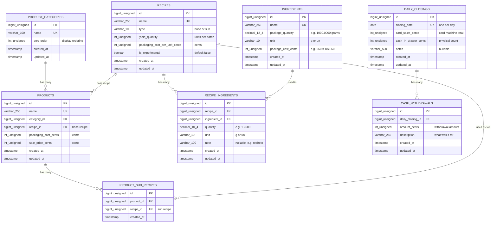

# Database Schema -- Forno Celeste

> **Version:** 2.0 -- Phase 1 (Ingredients, Recipes, Products, CMV) + Phase 2 (Daily Closings, Cash Withdrawals)
> **Engine:** MySQL 8.4 (InnoDB, utf8mb4_0900_ai_ci)
> **Owner:** database-manager agent

## ERD



## Table catalogue

| Table | Domain | Purpose | Estimated rows |
|---|---|---|---|
| `ingredients` | Catalog | Raw materials with package cost | ~50, grows slowly |
| `product_categories` | Catalog | Fixed list: Cookies, Paes Salgados, Paes Doces | ~5, near-static |
| `recipes` | Catalog | Base doughs and sub-recipes (toppings/fillings) | ~25, grows slowly |
| `recipe_ingredients` | Catalog | Ingredient lines per recipe (the BOM) | ~150, grows with recipes |
| `products` | Catalog | Sellable items with pricing | ~20, grows slowly |
| `product_sub_recipes` | Catalog | Which sub-recipes compose a product | ~20, grows with products |
| `daily_closings` | Finance | End-of-day cash register closing | ~300/year, one per business day |
| `cash_withdrawals` | Finance | Cash taken out of the drawer during/after the day | ~600/year, ~2 per day avg |

All tables are small (hundreds of rows at most for the foreseeable future). No partitioning, archiving, or cursor pagination needed at this scale. Standard `paginate()` is fine everywhere.

## Tables and columns

### `ingredients`

| Column | Type | Null | Default | Notes |
|---|---|---|---|---|
| `id` | `BIGINT UNSIGNED` | NO | auto-increment | PK |
| `name` | `VARCHAR(255)` | NO | -- | Unique. Includes brand, e.g. "Farinha (Dona Benta)" |
| `package_quantity` | `DECIMAL(12,4)` | NO | -- | Amount in the package (grams or units). DECIMAL because some packages are fractional. |
| `unit` | `VARCHAR(10)` | NO | -- | PHP enum-backed: `g`, `un`. VARCHAR avoids ALTER pain if a third unit is added. |
| `package_cost_cents` | `INT UNSIGNED` | NO | -- | Cost of one package in BRL cents. Max ~R$21 million -- more than enough. |
| `created_at` | `TIMESTAMP` | YES | `NULL` | Laravel convention |
| `updated_at` | `TIMESTAMP` | YES | `NULL` | Laravel convention |

**Derived value (not stored):** `cost_per_unit = package_cost_cents / package_quantity`. Calculated in PHP or SQL at query time.

### `product_categories`

| Column | Type | Null | Default | Notes |
|---|---|---|---|---|
| `id` | `BIGINT UNSIGNED` | NO | auto-increment | PK |
| `name` | `VARCHAR(100)` | NO | -- | Unique. E.g. "Cookies" |
| `sort_order` | `INT UNSIGNED` | NO | `0` | For display ordering |
| `created_at` | `TIMESTAMP` | YES | `NULL` | |
| `updated_at` | `TIMESTAMP` | YES | `NULL` | |

### `recipes`

| Column | Type | Null | Default | Notes |
|---|---|---|---|---|
| `id` | `BIGINT UNSIGNED` | NO | auto-increment | PK |
| `name` | `VARCHAR(255)` | NO | -- | Unique |
| `type` | `VARCHAR(10)` | NO | -- | PHP enum: `base`, `sub`. Determines where it can be used. |
| `yield_quantity` | `INT UNSIGNED` | NO | -- | How many units one batch produces. Always whole units. |
| `packaging_cost_per_unit_cents` | `INT UNSIGNED` | NO | `0` | Per-unit packaging cost at the recipe level (some recipes share packaging cost here). |
| `is_experimental` | `BOOLEAN` | NO | `false` | Flag for experimental recipes not yet in production rotation. |
| `created_at` | `TIMESTAMP` | YES | `NULL` | |
| `updated_at` | `TIMESTAMP` | YES | `NULL` | |

### `recipe_ingredients`

| Column | Type | Null | Default | Notes |
|---|---|---|---|---|
| `id` | `BIGINT UNSIGNED` | NO | auto-increment | PK |
| `recipe_id` | `BIGINT UNSIGNED` | NO | -- | FK to `recipes.id` |
| `ingredient_id` | `BIGINT UNSIGNED` | NO | -- | FK to `ingredients.id` |
| `quantity` | `DECIMAL(10,4)` | NO | -- | Amount used (1.2500 grams or 2.0000 units). 4 decimal places handle fractions like 1.25g. |
| `unit` | `VARCHAR(10)` | NO | -- | `g` or `un`. Must match ingredient's native unit for cost calculation to be meaningful. |
| `note` | `VARCHAR(100)` | YES | `NULL` | Clarification, e.g. "recheio" when the same ingredient appears twice in a recipe. |
| `created_at` | `TIMESTAMP` | YES | `NULL` | |
| `updated_at` | `TIMESTAMP` | YES | `NULL` | |

**Why allow duplicate ingredient per recipe:** The Cinnamon Roll recipe uses Manteiga twice (80g for dough, 45g for filling) and Acucar Cristal twice (85g dough, 45g filling). The `note` column distinguishes them. A unique constraint on `(recipe_id, ingredient_id)` would block this real data. No unique constraint here.

### `products`

| Column | Type | Null | Default | Notes |
|---|---|---|---|---|
| `id` | `BIGINT UNSIGNED` | NO | auto-increment | PK |
| `name` | `VARCHAR(255)` | NO | -- | Unique |
| `category_id` | `BIGINT UNSIGNED` | NO | -- | FK to `product_categories.id` |
| `recipe_id` | `BIGINT UNSIGNED` | NO | -- | FK to `recipes.id`. The base recipe. |
| `packaging_cost_cents` | `INT UNSIGNED` | NO | `0` | Product-level packaging cost in cents. Separate from recipe-level packaging. |
| `sale_price_cents` | `INT UNSIGNED` | NO | -- | Current selling price in cents |
| `created_at` | `TIMESTAMP` | YES | `NULL` | |
| `updated_at` | `TIMESTAMP` | YES | `NULL` | |

### `product_sub_recipes`

| Column | Type | Null | Default | Notes |
|---|---|---|---|---|
| `id` | `BIGINT UNSIGNED` | NO | auto-increment | PK (Laravel convention for pivots with timestamps or extra columns) |
| `product_id` | `BIGINT UNSIGNED` | NO | -- | FK to `products.id` |
| `recipe_id` | `BIGINT UNSIGNED` | NO | -- | FK to `recipes.id` (must be type=sub) |
| `created_at` | `TIMESTAMP` | YES | `NULL` | Only `created_at`, no `updated_at` -- pivot rows are replaced, not updated |

### `daily_closings`

| Column | Type | Null | Default | Notes |
|---|---|---|---|---|
| `id` | `BIGINT UNSIGNED` | NO | auto-increment | PK |
| `closing_date` | `DATE` | NO | -- | Unique. The local business date (Sao Paulo) this closing refers to. |
| `card_sales_cents` | `INT UNSIGNED` | NO | `0` | Total card machine revenue for the day in BRL cents. Default 0 for days with no card sales. |
| `cash_in_drawer_cents` | `INT UNSIGNED` | NO | -- | Physical cash counted at end of day. No default -- must be entered. |
| `notes` | `VARCHAR(500)` | YES | `NULL` | Optional notes about the day, e.g. "feriado, movimento fraco". |
| `created_at` | `TIMESTAMP` | YES | `NULL` | |
| `updated_at` | `TIMESTAMP` | YES | `NULL` | |

**Computed values (not stored):**
- `opening_cash_cents` = previous closing's `cash_in_drawer_cents` (by `closing_date` order). `NULL`/0 for the very first closing.
- `cash_sales_cents` = `cash_in_drawer_cents` - `opening_cash_cents` + SUM(`cash_withdrawals.amount_cents`)
- `total_revenue_cents` = `card_sales_cents` + `cash_sales_cents`
- `discrepancy_cents` = `cash_in_drawer_cents` - (`opening_cash_cents` + `cash_sales_cents` - SUM(`cash_withdrawals.amount_cents`))

Opening cash is retrieved via `LAG(cash_in_drawer_cents) OVER (ORDER BY closing_date)` for listings, or a single indexed query for a single record.

### `cash_withdrawals`

| Column | Type | Null | Default | Notes |
|---|---|---|---|---|
| `id` | `BIGINT UNSIGNED` | NO | auto-increment | PK |
| `daily_closing_id` | `BIGINT UNSIGNED` | NO | -- | FK to `daily_closings.id` |
| `amount_cents` | `INT UNSIGNED` | NO | -- | Withdrawal amount in BRL cents. Must be > 0 (enforced by validation, not CHECK). |
| `description` | `VARCHAR(255)` | NO | -- | What the money was used for, e.g. "pagamento fornecedor", "deposito bancario". |
| `created_at` | `TIMESTAMP` | YES | `NULL` | |
| `updated_at` | `TIMESTAMP` | YES | `NULL` | |

## Constraints and indexes

| Table | Index / Constraint | Columns | Serves which query |
|---|---|---|---|
| `ingredients` | PK | `id` | All lookups |
| `ingredients` | UNIQUE `ingredients_name_unique` | `name` | Prevents duplicate ingredients; seed lookup by name |
| `product_categories` | PK | `id` | All lookups |
| `product_categories` | UNIQUE `product_categories_name_unique` | `name` | Prevents duplicates |
| `recipes` | PK | `id` | All lookups |
| `recipes` | UNIQUE `recipes_name_unique` | `name` | Prevents duplicates |
| `recipes` | INDEX `recipes_type_index` | `type` | Filter recipes by type (base vs sub) |
| `recipe_ingredients` | PK | `id` | |
| `recipe_ingredients` | INDEX `recipe_ingredients_recipe_id_index` | `recipe_id` | "Get all ingredient lines for recipe X" -- the hottest query |
| `recipe_ingredients` | FK index `recipe_ingredients_ingredient_id_foreign` | `ingredient_id` | "Which recipes use ingredient X?" for CMV recalculation |
| `products` | PK | `id` | |
| `products` | UNIQUE `products_name_unique` | `name` | Prevents duplicates |
| `products` | INDEX `products_category_id_index` | `category_id` | "List products by category" |
| `products` | INDEX `products_recipe_id_index` | `recipe_id` | "Which products use base recipe X?" |
| `product_sub_recipes` | PK | `id` | |
| `product_sub_recipes` | UNIQUE `product_sub_recipes_product_recipe_unique` | `(product_id, recipe_id)` | Prevents attaching the same sub-recipe twice to one product |
| `product_sub_recipes` | INDEX (from unique) | `product_id` | "Get sub-recipes for product X" (covered by the unique's leading column) |
| `product_sub_recipes` | INDEX `product_sub_recipes_recipe_id_index` | `recipe_id` | "Which products use sub-recipe X?" for CMV impact |
| `daily_closings` | PK | `id` | All lookups by ID |
| `daily_closings` | UNIQUE `daily_closings_closing_date_unique` | `closing_date` | One closing per day; date lookups; ORDER BY closing_date for LAG() |
| `cash_withdrawals` | PK | `id` | All lookups by ID |
| `cash_withdrawals` | INDEX `cash_withdrawals_daily_closing_id_index` | `daily_closing_id` | "Get all withdrawals for closing X" |

### Foreign keys

| Table | Column | References | ON DELETE | Rationale |
|---|---|---|---|---|
| `recipe_ingredients` | `recipe_id` | `recipes.id` | `CASCADE` | Ingredient lines are owned children of a recipe. Deleting a recipe removes its lines. |
| `recipe_ingredients` | `ingredient_id` | `ingredients.id` | `RESTRICT` | Cannot delete an ingredient still used in recipes. Force the user to remove it from recipes first. |
| `products` | `category_id` | `product_categories.id` | `RESTRICT` | Cannot delete a category with products in it. |
| `products` | `recipe_id` | `recipes.id` | `RESTRICT` | Cannot delete a base recipe attached to a product. |
| `product_sub_recipes` | `product_id` | `products.id` | `CASCADE` | Pivot rows are owned children. Deleting a product cleans up its sub-recipe links. |
| `product_sub_recipes` | `recipe_id` | `recipes.id` | `RESTRICT` | Cannot delete a sub-recipe still attached to products. |
| `cash_withdrawals` | `daily_closing_id` | `daily_closings.id` | `CASCADE` | Withdrawals are owned children. Deleting a closing removes its withdrawals. |

## Migration plan

Ordered by dependency. All are reversible with `down()`.

1. **`create_ingredients_table`** -- no dependencies
2. **`create_product_categories_table`** -- no dependencies
3. **`create_recipes_table`** -- no dependencies
4. **`create_recipe_ingredients_table`** -- depends on #1 and #3
5. **`create_products_table`** -- depends on #2 and #3
6. **`create_product_sub_recipes_table`** -- depends on #3 and #5
7. **`create_daily_closings_table`** -- no dependencies on Phase 1 tables
8. **`create_cash_withdrawals_table`** -- depends on #7

All tables are new on an empty database, so zero-downtime concerns do not apply. Standard `Schema::create` / `Schema::dropIfExists` is sufficient.

## Money handling strategy

**Integer cents everywhere.** Every monetary column is `INT UNSIGNED` (or `BIGINT UNSIGNED` if the value could exceed ~R$21 million, which is not the case here).

- `package_cost_cents` -- cost in BRL cents. R$5.60 is stored as `560`.
- `packaging_cost_per_unit_cents` -- cents.
- `packaging_cost_cents` -- cents.
- `sale_price_cents` -- cents.
- `card_sales_cents` -- daily card machine total in cents.
- `cash_in_drawer_cents` -- physical cash count in cents.
- `amount_cents` (cash_withdrawals) -- withdrawal amount in cents.

Conversion to reais happens only at the presentation layer (API Resources / Blade views). Division by 100 with rounding is done in PHP (`number_format($cents / 100, 2)`), never in the database.

**Seed data note:** The JSON files have costs in reais as floats (e.g. `5.60`). The seeder must multiply by 100 and round to integer: `(int) round($cost * 100)`.

## Quantity handling

**`DECIMAL(10,4)` for all quantities and `DECIMAL(12,4)` for package quantities.**

- Ingredient quantities can be fractional: 1.25g of salt, 0.5 units. Four decimal places cover the data.
- Package quantity uses `DECIMAL(12,4)` for slightly larger values (5000g packages).
- `yield_quantity` is `INT UNSIGNED` because batches always produce whole units.
- The unit column is `VARCHAR(10)` backed by a PHP enum (`MeasurementUnit::Grams`, `MeasurementUnit::Units`). This avoids MySQL native ENUM columns which require ALTER TABLE to add values.

## CMV computation strategy

**Compute on read, do not store.**

Reasons:
1. **Small dataset.** ~20 products, ~25 recipes, ~150 ingredient lines. The join and arithmetic cost is negligible.
2. **Correctness.** When an ingredient price changes, a stored CMV is instantly stale. Computing avoids cache invalidation complexity.
3. **Simplicity.** No triggers, no events, no background jobs to keep a `cmv_cents` column in sync.

The CMV formula per product:

```
base_recipe_ingredient_cost = SUM(ri.quantity * (i.package_cost_cents / i.package_quantity))
                              for each ingredient line in the base recipe
                              / recipe.yield_quantity

sub_recipe_costs = for each sub-recipe attached to the product:
                     SUM(ri.quantity * (i.package_cost_cents / i.package_quantity))
                     / sub_recipe.yield_quantity

cmv_cents = base_cost_per_unit
          + SUM(sub_recipe_cost_per_unit)
          + product.packaging_cost_cents
          + base_recipe.packaging_cost_per_unit_cents

cmv_percent = cmv_cents / sale_price_cents * 100
```

This can be a single SQL query with subqueries, or more readably, computed in the repository/service using eager-loaded relationships. Given the data size, the eager-load approach is cleaner and easier to test.

**Future consideration:** If the product catalog grows to hundreds of items and the CMV list page becomes slow (unlikely), a materialized `cmv_cache_cents` column can be added with an event-driven update. That is a Phase 2 concern.

## Transactions, locking, concurrency

- **Ingredient price update:** single-row UPDATE, no transaction needed beyond the implicit one. CMV is computed on read, so no cascade update is required.
- **Recipe creation with ingredients:** INSERT recipe + INSERT N ingredient lines should be wrapped in a transaction in the service layer.
- **Product creation with sub-recipes:** INSERT product + INSERT N pivot rows should be wrapped in a transaction.
- **Daily closing creation with withdrawals:** INSERT `daily_closings` + INSERT N `cash_withdrawals` rows should be wrapped in a transaction. If any withdrawal insert fails, the closing must not persist.
- **Daily closing update:** UPDATE closing + sync withdrawals (delete-all, reinsert) in a transaction. Simple and correct since withdrawal rows have no external references.
- **Unique `closing_date` constraint:** prevents double-closing for the same date. Service should catch the duplicate key error and return a friendly message.
- **No race conditions at this scale:** single user (bakery owner), no concurrent writes to worry about. No `lockForUpdate` needed.
- **Upsert for seeding:** the seeder can use `firstOrCreate` or `updateOrCreate` by name to be idempotent.

## Data volume and growth

This is a single-bakery app. Expected maximums:

| Table | Current | 1-year estimate | 3-year estimate |
|---|---|---|---|
| `ingredients` | 41 | 60 | 100 |
| `product_categories` | 3 | 5 | 8 |
| `recipes` | 20 | 40 | 80 |
| `recipe_ingredients` | ~120 | 250 | 500 |
| `products` | 13 | 30 | 60 |
| `product_sub_recipes` | ~15 | 40 | 80 |
| `daily_closings` | 0 | ~300 | ~900 |
| `cash_withdrawals` | 0 | ~600 | ~1800 |

No pagination strategy needed beyond default. No archiving. No sharding. Standard `paginate(20)` if listing pages are built.

## Needs from architect

1. Confirm the `Catalog` domain grouping for all these entities.
2. Decide which repository owns the CMV computation: `ProductRepositoryInterface` with eager-loaded recipes and ingredients, or a dedicated `CmvService` that orchestrates the calculation.
3. Confirm the `MeasurementUnit` enum lives in `app/Enums/Catalog/`.
4. Confirm the `RecipeType` enum (`base`, `sub`) lives in `app/Enums/Catalog/`.

## Risks

1. **Packaging cost lives in two places:** `recipes.packaging_cost_per_unit_cents` and `products.packaging_cost_cents`. The seed data shows both are needed (recipe-level for shared dough costs like Focaccia's R$0.40, product-level for final wrapping like R$0.47 per cinnamon roll). This is intentional but could confuse developers. Documenting it clearly.
2. **Duplicate ingredients per recipe:** Cinnamon Roll uses Manteiga and Acucar Cristal twice each (dough vs filling). The `note` column handles this, but there is no unique constraint to prevent accidental true duplicates. Validation in the form request layer should warn if the same ingredient appears twice without a note.
3. **Unit mismatch:** nothing in the schema prevents a recipe ingredient line from using `unit=g` for an ingredient whose `unit=un` (eggs). Validation must enforce that `recipe_ingredients.unit` matches the referenced `ingredient.unit`. This is a service/request-layer concern, not a CHECK constraint, because MySQL CHECK constraints cannot reference other tables.

VERDICT: PLAN READY
